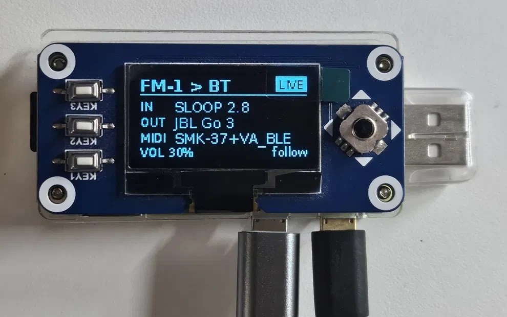
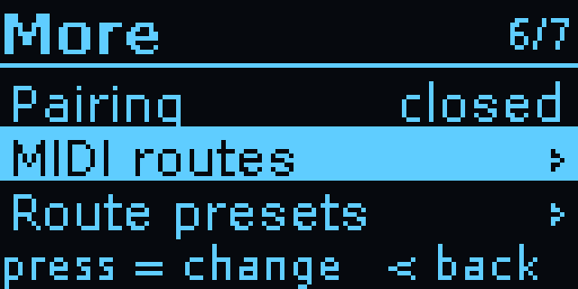

# FM-1 Sloop/Felucca Companion Device

[](https://cdn.jsdelivr.net/gh/nervseele89/FM-1-Sloop-Falucca-Companion-Device@main/docs/video/fm1-bridge-demo.mp4)

**[▶ Watch the demo](https://cdn.jsdelivr.net/gh/nervseele89/FM-1-Sloop-Falucca-Companion-Device@main/docs/video/fm1-bridge-demo.mp4)**
(1:46, with sound): the box's own screens, all eleven meters, settings, the MIDI matrix and the library,
with an overlay of each button press. The music was played on the FM-1 and recorded by the box.



A small Bluetooth box for the **M-VAVE FM-1** pocket synth running custom firmware such as
[Sloop](https://github.com/isod89/sloop-fm1) or [Felucca](https://github.com/hugelton/Felucca).
Those firmwares never switch the FM-1's radio on, so this adds the Bluetooth from outside: a
Raspberry Pi Zero W with a Waveshare 1.3" OLED HAT, connected to the FM-1 by USB.

- **Audio out:** the FM-1's USB audio plays on Bluetooth headphones or a speaker.
- **MIDI in and out:** the Pi shows up as a Bluetooth MIDI device, **"FM-1 Bridge"**, so a
  keyboard, iPad, phone or computer can play the FM-1 wirelessly and receive what it sends.
- **For playing:** record the FM-1 from the box, play takes back or resample them into the FM-1, a MIDI
  clock (tempo readout, or the box as clock master with tap tempo and Start/Stop) with a metronome, arp and
  chord memory, and a MIDI matrix that routes, transposes, re-channels, reshapes velocity and filters MIDI.
- **Eleven meters:** level bars, VU needles, spectrum, scope, a reel-to-reel tape deck, a tuner, a MIDI
  keyboard view, a waterfall, a stereo goniometer, a level history and a beat counter.
- **A library for the FM-1 (v2, SLOOP 2.3+):** back up and restore everything on it, load projects and
  samples, and install firmware (it downloads [SLOOP](https://github.com/isod89/sloop-fm1) and, if you
  want it, isod89's experimental synthesizer firmware [Clipper](https://github.com/isod89/clipper-fm1)),
  from the box or from a web page on your phone. No computer needed. Backups are SLOOP's own backup files,
  so they also open in SLOOP's web editor.
- **Its own screen and controls:** status, meters, settings and the library on the HAT's OLED, keys and
  joystick. Ready about a minute after power-on.

```
                         ┌──Bluetooth A2DP───▶ headphones / speaker
FM-1 ──USB──▶ Pi Zero W ─┤
 (audio + MIDI)          └◀─Bluetooth LE MIDI─▶ keyboard / iPad / phone / Mac
```

Tested with a Pi Zero W on Raspberry Pi OS Lite (Trixie), Sloop 2.7 and 2.8 on the FM-1, a JBL Go 3
speaker and an M-VAVE SMK-37 keyboard over Bluetooth MIDI (including its clock). The library was tested on
the real FM-1 with a backup, a restore (read back byte for byte), a project load, a sample load and the
update from SLOOP 2.7.1 to 2.8 (projects, presets and samples kept). The meters were checked on the box with
music playing: about a quarter of the CPU while shown, and no audio dropouts.

## What's new in v2.3


**New**
- **Six more meters** (eleven in all): **Tuner** (the note, its frequency and cents off, boxed when in
  tune; for samples, patches and other instruments), **MIDI** (a three-octave keyboard lighting the notes
  played to and from the FM-1, the chord's name, and which channels are busy), **Waterfall** (a scrolling
  spectrogram), **Stereo** (goniometer and correlation), **History** (the last 50 s of level) and **Beat**
  (big BPM and a 1-2-3-4 counter in time with the clock, from MIDI alone).
- **Recordings menu** (Library → Recordings ›): **Play** a take on the speaker over the FM-1's live sound,
  **Load into slot ›** to resample it into the FM-1 (its first 7.3 s of sound, trimmed and faded, with the
  note it plays detected so the sample plays in tune; also on the web page), or **Delete**.
- **Metronome:** a click on the speaker in time with the box's clock or an incoming one (beat 1 higher),
  three levels. It runs next to the clock on a real-time thread, so it stays steady.
- **Arp and chord memory** for the keyboard: one-press **Arp** and **Chord** switches in Settings. The arp
  plays held keys (chords included) in time with the clock: up, down, up-down, as played or random; 1/4 to
  1/16; 1–3 octaves. It keeps its own time at the Tempo setting when there's no clock.
- **Route presets:** save the MIDI matrix in one of four slots and load it back.
- **Settings in one list:** what you change while playing (Metronome, Tempo, Clock, Arp, Chord, Speaker)
  one press away; what's set once under **More ›**.

**Fixed and faster**
- **The controls react at once:** screens redraw in about 8 ms instead of 50–60 ms (text is drawn once and
  reused).
- **A Bluetooth MIDI keyboard no longer needs a power cycle** after the bridge restarts (or connects
  before it at boot): the box reconnects it, and its MIDI flows again in about 15 s.
- **Following an external clock is steadier:** the tempo and beat grid are fitted to the last 48 ticks, so
  ticks bunched by the radio don't make the beat or the metronome wobble.

<details><summary>Earlier: v2.2</summary>

Recording to WAV from any meter screen (REC on the screen; stops safely; recordings on the web page), the
Tape meter, MIDI clock (follow or box clock, tap tempo, hold for Start/Stop), the MIDI matrix (per route:
channels, transpose, velocity, drop clock/aftertouch/bend; note-offs always follow their note-ons), and the
Audio rate setting (v2.1.1) that also restarts a silent FM-1 audio stream.
</details>

## Screens

| | |
|---|---|
|  |  |
| **Status:** the FM-1 input, the speaker, the MIDI device (the dot blinks with MIDI traffic), the volume and the clock. LIVE means audio is flowing. | **Recording:** REC and the time in place of LIVE. |
|  |  |
| **Settings** (joystick right): Metronome, Tempo, Clock, Arp, Chord, Speaker, Library, Wi-Fi, then More. | **More ›:** Bluetooth audio, the audio rate, the click level, Bluetooth MIDI, pairing, the MIDI routes and their presets. |
|  |  |
| **MIDI routes:** a filled square is a route that's on. Press opens it. | **A route:** here the keyboard is played an octave up with a soft velocity curve. |
|  |  |
| **Library:** back up, restore, load a project or a sample, recordings, firmware, the SD card. Writes ask you to hold the joystick press for 2 seconds, and back up first. | **A job running:** here a SLOOP update, about 2 minutes. |
|  |  |
| **A recording:** play it, load it into a sample slot, or delete it. | **Playing** a take on the speaker. |
|  |  |
| **Speakers and headphones** found by a scan (KEY1): pick one with the joystick. | **Pairing**, then it's remembered and reconnects by itself. |
|  |  |
| **Screensaver** after five minutes: one small word that moves, so the OLED doesn't burn in. | **Starting:** shown as soon as the bridge opens the screen at boot, until the status screen is ready. |

### Meters

Joystick left from the status screen. Up/down switches meter (the box remembers your choice), press
records, right goes back. The screen stays on while sound (or MIDI) plays.

| | |
|---|---|
|  |  |
| **Bars:** left and right peak level from −48 to 0 dBFS, with a peak hold and CLIP. | **VU:** two needles with real VU ballistics (0 VU = −18 dBFS); the dot lights on peaks. |
|  |  |
| **Spectrum:** 16 bands from 50 Hz to 7.5 kHz, with falling peak caps. | **Scope:** the waveform, held steady on a rising zero crossing. |
|  |  |
| **Tape:** a reel-to-reel deck, here 1 min 23 s into a recording. | **Tuner:** the note, how far off in cents, its frequency; boxed when within 5 cents. |
|  |  |
| **MIDI:** the notes played and the chord's name; below, the busy channels. | **Waterfall:** the spectrum over the last ~5 s, newest at the top. |
|  |  |
| **Stereo:** mono is a vertical line, wide stereo a cloud; correlation below. | **History:** the peak level over the last ~50 s. |
|  | |
| **Beat:** the tempo and the beat in the bar, flashing in time. | |

The screen images are drawn by the bridge's own code (`tools/render_screens.py`).

## Getting started

Everything is in [`fm1-bt-bridge/`](fm1-bt-bridge/). Its [README](fm1-bt-bridge/README.md)
covers what to buy, flashing the SD card, installing, the controls and troubleshooting. In short:

```
scp -r fm1-bt-bridge YOUR_USER@fm1bridge.local:~
ssh YOUR_USER@fm1bridge.local
bash fm1-bt-bridge/install.sh
sudo reboot
```

## Repository

| Path | What it is |
|---|---|
| `fm1-bt-bridge/bridge.py` | The OLED app: status and settings screens, headphone pairing, audio routing (PipeWire), keys |
| `fm1-bt-bridge/blemidi.py` | The Bluetooth LE MIDI service (BlueZ), its link to the FM-1's USB MIDI, the clock, the MIDI matrix with its arp and chord memory, and the metronome, in a process of its own |
| `fm1-bt-bridge/libui.py` | The Library screens on the box |
| `fm1-bt-bridge/meters.py` | The eleven meters, recording and playback, pitch detection |
| `fm1-bt-bridge/midiui.py` | The MIDI matrix screens on the box |
| `fm1-bt-bridge/metronome.py` | The metronome's click stream (run by the MIDI process) |
| `fm1-bt-bridge/library.py` | The library's jobs (backup, restore, projects, samples, firmware); also a command-line tool |
| `fm1-bt-bridge/sloop.py` | SLOOP's editor protocol over USB MIDI: backups, projects, sample slots |
| `fm1-bt-bridge/web.py` | The library's web page (http://fm1bridge.local while Wi-Fi is on) |
| `fm1-bt-bridge/vendor/sloop/` | SLOOP's firmware installer and sample converter, copied unchanged (GPL-3.0, credited in `VENDORED.md`) |
| `fm1-bt-bridge/install.sh` | Installs packages, configuration and the boot services on the Pi |
| `fm1-bt-bridge/config/` | PipeWire, WirePlumber, polkit, systemd, swap, Wi-Fi and SD-card helper configuration |
| `tests/` | A pretend FM-1 speaking SLOOP's protocol, and tests for the library, the screens, the meters, recording and playback, MIDI, the clock, the metronome and the web page (`python tests/test_library.py` etc.; needs mido, Pillow and numpy) |
| `tools/midi_timing.py` | Analyses the bridge's Bluetooth MIDI timing log (`/dev/shm/fm1-midi-timing.log` on the Pi) |
| `tools/render_screens.py` | Draws the OLED screens as PNG files for this README, without a Pi |
| `docs/images/` | The photo and screen images |

## Known limits

- **Bluetooth audio delay:** about 150–250 ms (SBC). Fine for listening and practising; you'll
  notice it when playing tightly in time.
- **Plugging the FM-1 in while the Pi is running can reboot the Pi.** The Zero's USB port has no
  current limit. Connect the FM-1 first, or use a powered USB hub.
- **Chords over Bluetooth MIDI arrive slightly rolled** (10–50 ms) with keyboards that send
  each note in its own packet.
- **Start-up still takes about a minute** on a Pi Zero W's single core; Wi-Fi comes up about 40 s
  after the bridge. The optional `config/fm1-native-wifi` step (see the
  [box README](fm1-bt-bridge/README.md)) saves NetworkManager about a minute more.

## License

GPL-3.0, like Sloop and Felucca. See [LICENSE](LICENSE).
