# FM-1 Companion

[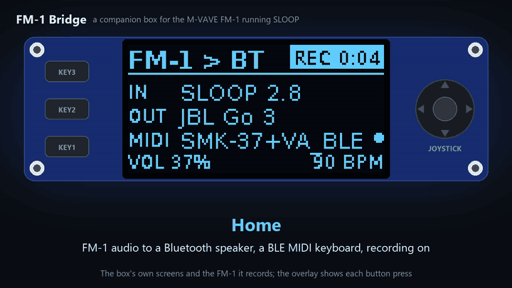](https://cdn.jsdelivr.net/gh/nervseele89/FM-1-Companion@main/docs/video/fm1-companion-demo-v2.6.1.mp4)

**[▶ Watch the demo](https://cdn.jsdelivr.net/gh/nervseele89/FM-1-Companion@main/docs/video/fm1-companion-demo-v2.6.1.mp4)**
(1:46, with sound): the box's own screens, all eleven meters, the settings, the MIDI matrix and the sample
editor, with an overlay of each button press. The music was played on the FM-1 and recorded by the box.

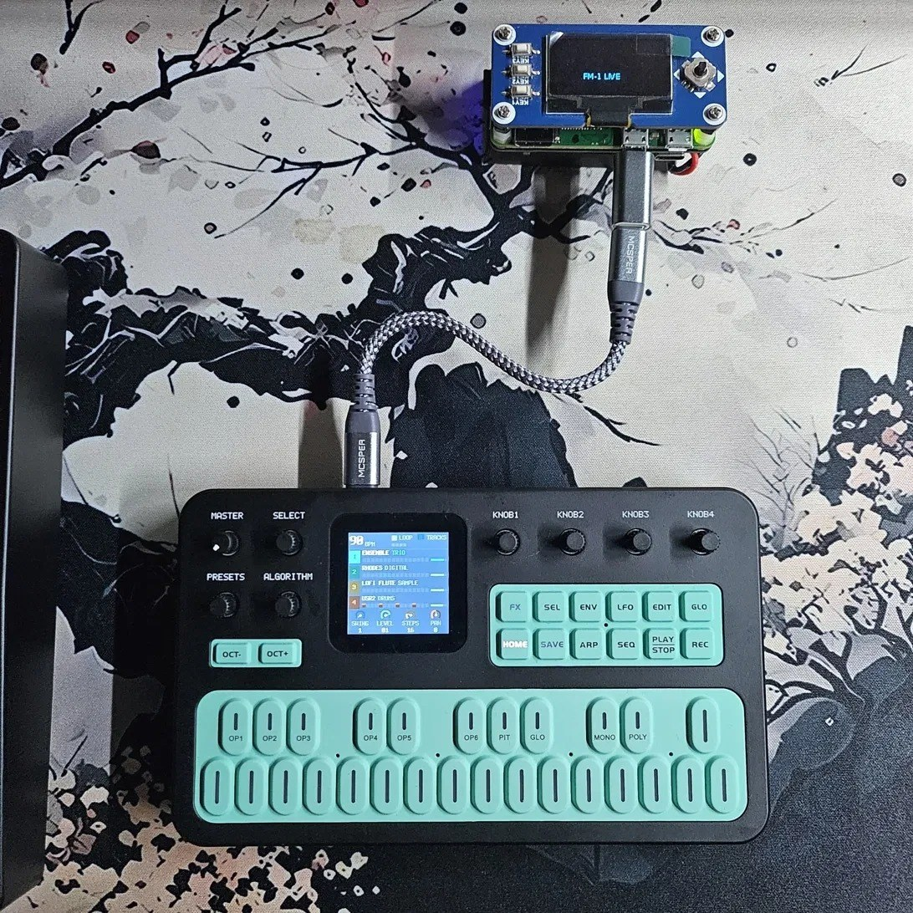

A pocket-sized companion box for the **M-VAVE FM-1** pocket synth running custom firmware such as
[Sloop](https://github.com/isod89/sloop-fm1). It started as a way to add the Bluetooth those firmwares leave switched off, and grew into a small studio
sidekick: it plays the FM-1 through wireless speakers and keyboards, records it, shapes its MIDI, shows what
it's doing on eleven meters, and looks after everything stored on it, with no computer needed. It's a
Raspberry Pi Zero W with a Waveshare 1.3" OLED HAT, plugged into the FM-1 by USB, and you run it from its
own screen and joystick or from your phone.

- **Wireless audio and MIDI:** the FM-1 plays on Bluetooth headphones or a speaker, and the box shows up
  as a Bluetooth MIDI device, **"FM-1 Companion"**, so a keyboard, iPad, phone or computer can play the FM-1
  and hear back what it sends.
- **USB keyboards:** put a USB hub between the box and the FM-1 and plug in up to four USB MIDI keyboards
  or controllers. They're found by themselves and play the FM-1 straight away.
- **A recorder and a sample editor:** record the FM-1 to WAV from the box, play takes back on the speaker,
  and edit a take (or any sample) into a new sample: trim it, fade it, normalize or reverse it, and tune it
  to the note it plays, ready to load into the FM-1.
- **Playing tools:** a MIDI clock (follow your keyboard's clock, or be the master with tap tempo and
  Start/Stop), a metronome, an arpeggiator and chord memory.
- **A MIDI matrix:** route Bluetooth, USB keyboards, the FM-1 and the box to each other; transpose,
  re-channel, reshape velocity and filter, with four presets.
- **Eleven meters:** level bars, VU needles, spectrum, scope, a reel-to-reel tape deck, a tuner, a MIDI
  keyboard view, a waterfall, a stereo goniometer, a level history and a beat counter.
- **Looks after the FM-1 (SLOOP 2.3+):** back up and restore everything on it (by hand or automatically),
  load projects and samples, and install firmware. It downloads [SLOOP](https://github.com/isod89/sloop-fm1)
  and, if you want it, isod89's experimental synthesizer firmware [Clipper](https://github.com/isod89/clipper-fm1).
  Backups are SLOOP's own backup files, so they also open in SLOOP's web editor.
- **A web app on your phone** (`http://fm1bridge.local`, Wi-Fi on): live status, volume and the playing
  settings, the MIDI matrix, a sample editor with a waveform you drag, recordings you can play in the browser,
  and uploads and downloads for the library.
- **Its own screen and controls:** status, meters and a short settings menu in sections, on the HAT's OLED,
  keys and joystick. Ready about a minute after power-on.
- **Coming in v3:** 5-pin DIN MIDI In, Out and Thru.

```
                            ┌── Bluetooth audio ──▶ headphones / speaker
                            ├◀── Bluetooth MIDI ──▶ keyboard / iPad / phone / Mac
FM-1 ◀── USB ──▶ Pi Zero W ─┤
 (audio, MIDI, backups,     ├◀── USB hub ─────────▶ USB MIDI keyboards
  samples, firmware)        ├◀── Wi-Fi ───────────▶ web app on your phone
                            └── OLED + joystick: meters, recorder, sample editor
```

Tested with a Pi Zero W on Raspberry Pi OS Lite (Trixie), Sloop 2.7 and 2.8 on the FM-1, a JBL Go 3
speaker and an M-VAVE SMK-37 keyboard over Bluetooth MIDI (including its clock) and over USB through an
ASMedia ASM1074 USB hub. The library was tested on the real FM-1 with a backup, a restore (read back byte for byte), a project load, a sample load and the
update from SLOOP 2.7.1 to 2.8 (projects, presets and samples kept). The meters were checked on the box with
music playing: about a quarter of the CPU while shown, and no audio dropouts.

## What's new in v2.7

| A USB keyboard playing the FM-1 | The matrix, with USB |
|---|---|
|  | 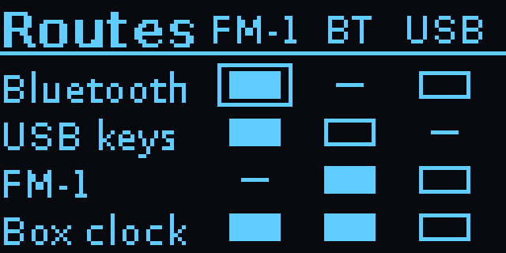 |
| 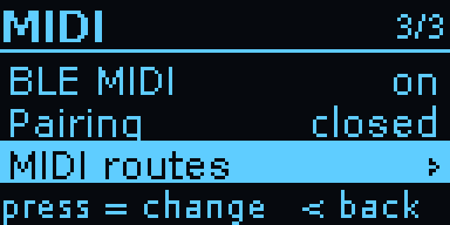 | |

**New**
- **USB MIDI keyboards:** plug a USB hub into the box, the FM-1 and up to four USB MIDI keyboards or
  controllers into the hub, and the keyboards play the FM-1, no Bluetooth needed. They're found within a
  few seconds of plugging in, and unplugging one is fine. Tested with an M-VAVE SMK-37.
- **USB in the MIDI matrix:** a *USB keys* row and a *USB* column, with all the usual route options
  (channels, transpose, velocity, filters, chord memory and the arpeggiator). USB keys → FM-1 is on at first;
  sending to the keyboards, and USB keys → Bluetooth, are yours to switch on. The Arp and Chord quick
  switches work for USB keyboards too.
- **Where you see them:** the home screen names the keyboard ("SMK-37+VA", or "1 USB + …" next to a
  Bluetooth device), Settings › MIDI › **USB keys** counts and lists them, and the web app shows them on its
  status page and in its routes grid.
- **The FM-1 is only ever found by its name** (or its USB ID), so a keyboard is never mistaken for it, and
  with no FM-1 plugged in the box no longer picks up a keyboard's own audio as the FM-1's.

**Good to know:** devices behind a USB 2 hub time out on the Pi Zero at high speed, so the installer now
sets the box's USB to full speed, 12 Mbit/s (`dwc_otg.speed=1`, from the next boot); the FM-1 and USB
keyboards are 12 Mbit/s devices anyway. A
bonus: with the FM-1 on the hub, you can unplug it from the hub and plug it back in while the box runs, with
no reboot.

<details><summary>Earlier: v2.6</summary>

Runs on a [PiSugar 3](https://docs.pisugar.com/docs/product-wiki/battery/pisugar3/pisugar-3-series)
battery, with its charge in the title bar and the web app, a warning at 15% and a safe shutdown at 5%; a new
demo video; recordings warn when the FM-1 clipped (v2.6.2).

| On battery | Plugged in |
|---|---|
| 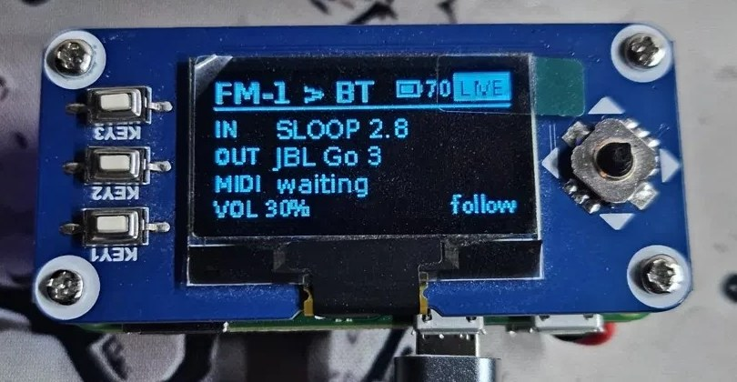 | 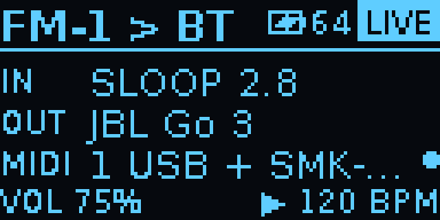 |
</details>

<details><summary>Earlier: v2.5</summary>

A sample editor on the box and in the web app: start from a recording or a sample, set the start and end,
fades, normalize, reverse and the root note (found by listening), play it, and save it as a new sample with
its note in the name, ready for Sloop › Load sample. Recordings no longer go straight into a slot.
</details>

<details><summary>Earlier: v2.4</summary>

Settings in sections (Playing, Audio, MIDI, Recordings, Wi-Fi, Sloop, FM-1), a bigger web app (live status
and controls, the MIDI matrix with named presets, recordings in the browser), the Sample level setting, a
big volume bar with 2% steps, faster hold-repeat, the home screen naming the firmware (SLOOP 2.8) and the
keyboard, recordings that keep all their audio, and sample loads that convert in about half the time.
</details>

<details><summary>Earlier: v2.3</summary>

Six more meters (Tuner, MIDI, Waterfall, Stereo, History, Beat), the Recordings menu (play a take, resample
it into a slot, delete), a metronome, arp and chord memory with one-press switches, route presets, controls
that react at once (screens redraw in about 8 ms), a Bluetooth MIDI keyboard that reconnects by itself after
the Companion restarts, and a steadier external clock.
</details>

<details><summary>Earlier: v2.2</summary>

Recording to WAV from any meter screen (REC on the screen; stops safely; recordings on the web page), the
Tape meter, MIDI clock (follow or box clock, tap tempo, hold for Start/Stop), the MIDI matrix (per route:
channels, transpose, velocity, drop clock/aftertouch/bend; note-offs always follow their note-ons), and the
Audio rate setting (v2.1.1) that also restarts a silent FM-1 audio stream.
</details>

## Screens

| | |
|---|---|
|  | 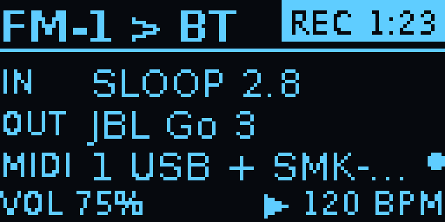 |
| **Status:** the FM-1 input, the speaker, the MIDI device (the dot blinks with MIDI traffic), the volume and the clock. LIVE means audio is flowing; the battery's charge is next to it. | **Recording:** REC and the time in place of LIVE. |
|  | 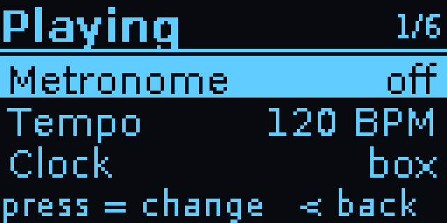 |
| **Settings** (joystick right): Playing, Audio, MIDI, Recordings, Sample editor, Wi-Fi, Sloop and FM-1. Press opens a section, left goes back. | **Playing ›:** Metronome, Tempo, Clock, Arp, Chord and the click level. **Audio ›** has the speaker and the audio rate; **MIDI ›** is below. |
| 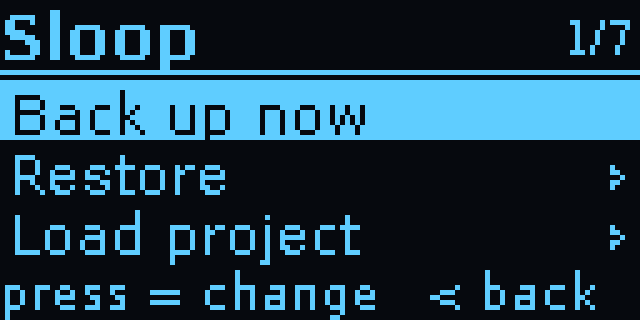 | 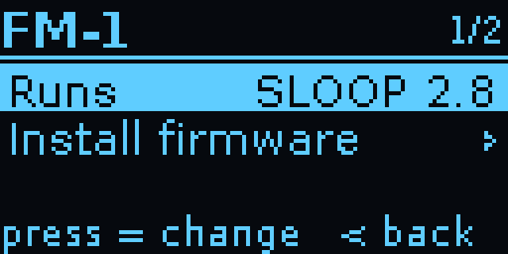 |
| **Sloop ›:** back up, restore, load a project or a sample, the sample level, auto backup, the SD card. Writes ask you to hold the joystick press for 2 seconds; restores and project loads back up first. | **FM-1 ›:** what the FM-1 runs, and installing firmware (SLOOP and Clipper download from GitHub with Wi-Fi on). |
|  |  |
| **MIDI ›:** Bluetooth MIDI, pairing, the USB keyboards plugged in (press lists them), the routes and their presets. | **MIDI routes:** rows are sources (Bluetooth, USB keyboards, the FM-1, the box's clock), columns destinations; a filled square is a route that's on. Press opens it. |
| 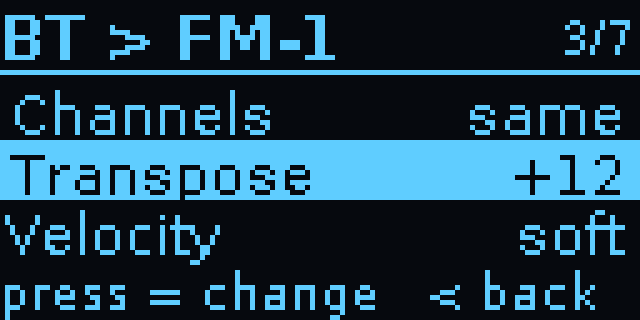 | 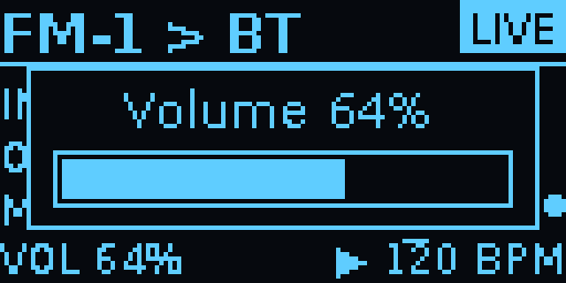 |
| **A route:** here the keyboard is played an octave up with a soft velocity curve. | **Volume:** up/down on the home screen, in 2% steps, shown big for a moment. |
|  | 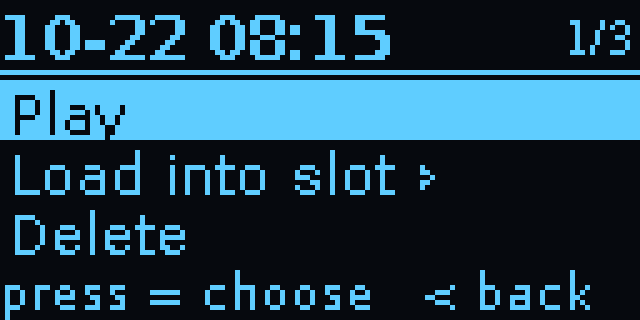 |
| **A job running:** here a SLOOP update, about 2 minutes. | **A recording:** play it, edit it as a sample, or delete it. |
| 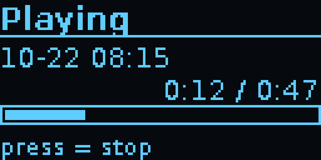 | 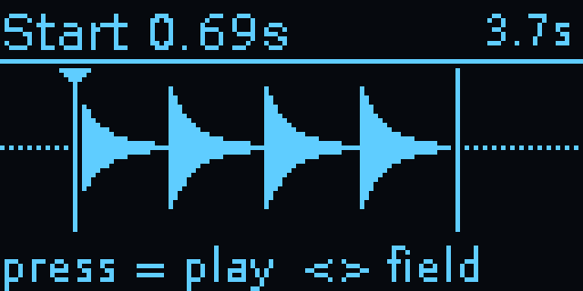 |
| **Playing** a take on the speaker. | **Sample editor:** the selection between two markers (outside it, dotted); left/right picks the field, up/down changes it, press plays it. The length is top right. |
| 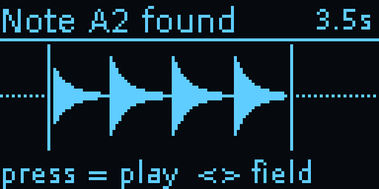 | 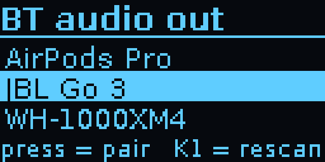 |
| **Note:** the root note it found by listening (up/down changes it). It goes into the saved file's name so SLOOP plays the sample in tune. | **Speakers and headphones** found by a scan (KEY1): pick one with the joystick. |
| 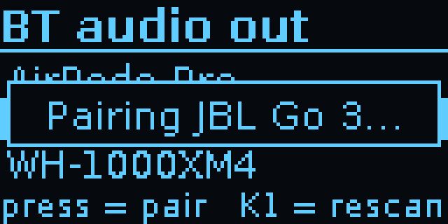 | 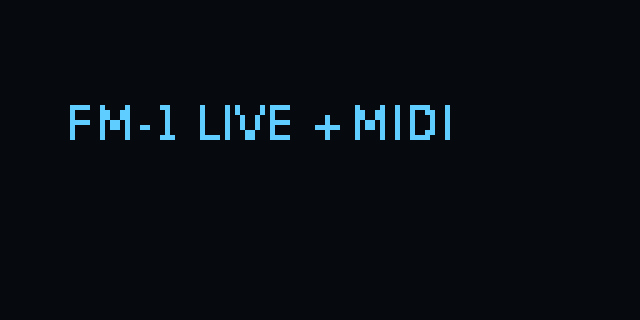 |
| **Pairing**, then it's remembered and reconnects by itself. | **Screensaver** after five minutes: one small word that moves, so the OLED doesn't burn in. |
| 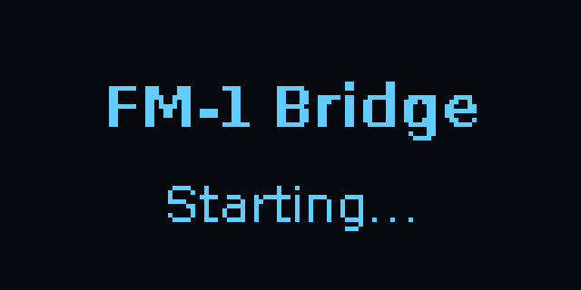 |  |
| **Starting:** shown as soon as the Companion opens the screen at boot, until the status screen is ready. |  |

### Meters

Joystick left from the status screen. Up/down switches meter (the box remembers your choice), press
records, right goes back. The screen stays on while sound (or MIDI) plays.

| | |
|---|---|
| 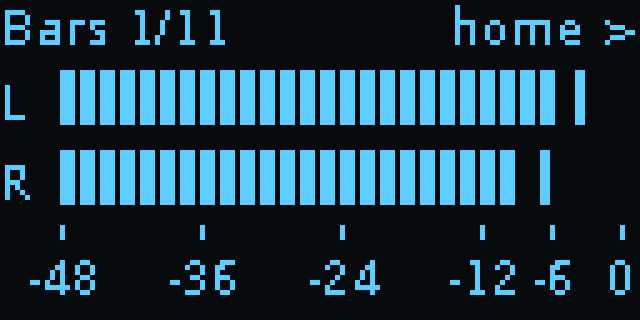 | 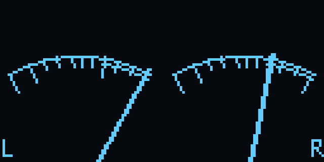 |
| **Bars:** left and right peak level from −48 to 0 dBFS, with a peak hold and CLIP. | **VU:** two needles with real VU ballistics (0 VU = −18 dBFS); the dot lights on peaks. |
| 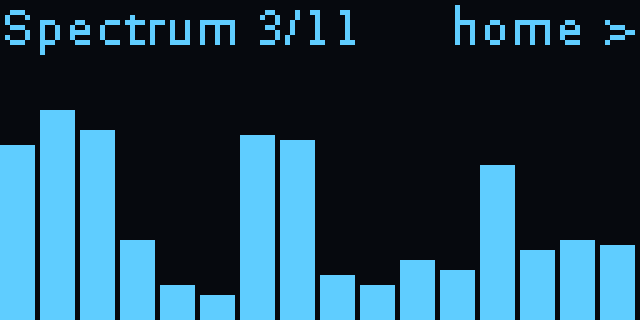 | 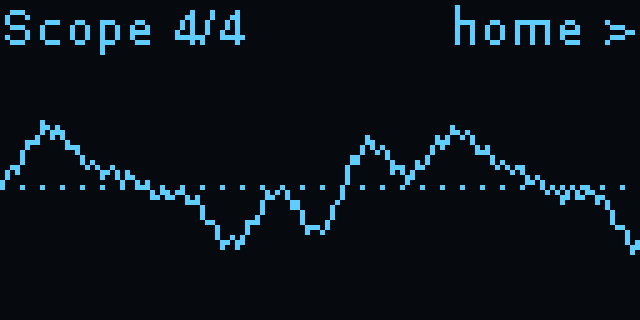 |
| **Spectrum:** 16 bands from 50 Hz to 7.5 kHz, with falling peak caps. | **Scope:** the waveform, held steady on a rising zero crossing. |
| 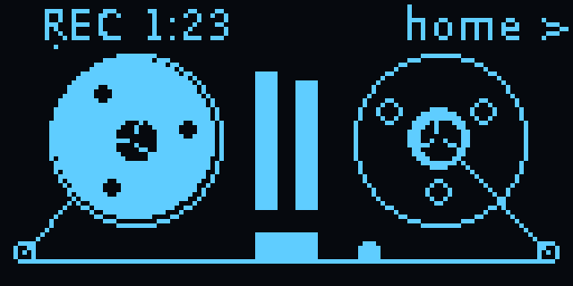 | 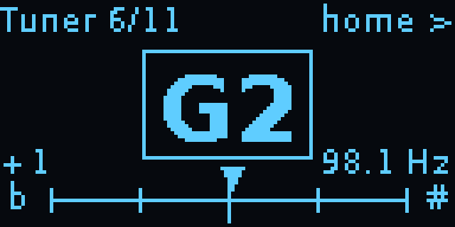 |
| **Tape:** a reel-to-reel deck, here 1 min 23 s into a recording. | **Tuner:** the note, how far off in cents, its frequency; boxed when within 5 cents. |
| 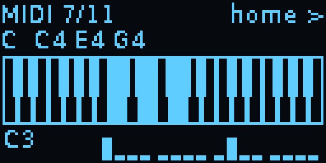 | 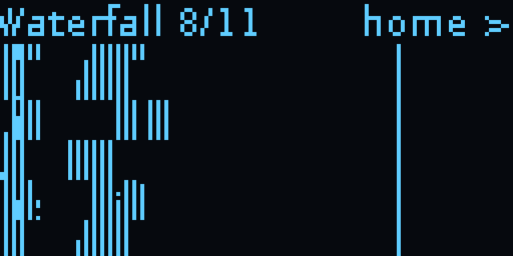 |
| **MIDI:** the notes played and the chord's name; below, the busy channels. | **Waterfall:** the spectrum over the last ~5 s, newest at the top. |
| 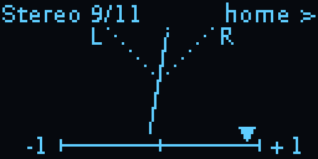 | 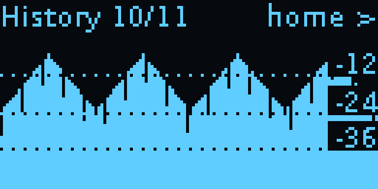 |
| **Stereo:** mono is a vertical line, wide stereo a cloud; correlation below. | **History:** the peak level over the last ~50 s. |
| 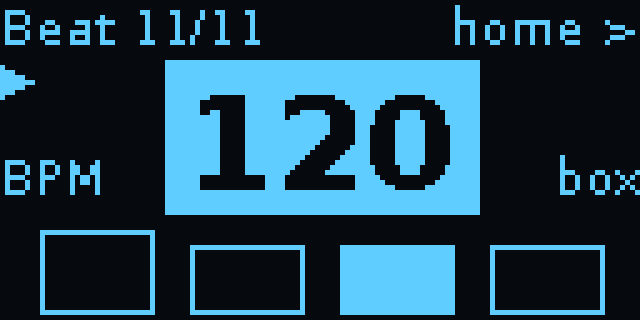 | |
| **Beat:** the tempo and the beat in the bar, flashing in time. | |

The screen images are drawn by the Companion's own code (`tools/render_screens.py`).

## Getting started

Everything is in [`fm1-bt-bridge/`](fm1-bt-bridge/). Its [README](fm1-bt-bridge/README.md)
covers what to buy, flashing the SD card, installing, the controls and troubleshooting. In short:

```
scp -r fm1-bt-bridge YOUR_USER@fm1bridge.local:~
ssh YOUR_USER@fm1bridge.local
bash fm1-bt-bridge/install.sh
sudo reboot
```

## Repository

| Path | What it is |
|---|---|
| `fm1-bt-bridge/bridge.py` | The OLED app: status and settings screens, headphone pairing, audio routing (PipeWire), keys |
| `fm1-bt-bridge/blemidi.py` | The Bluetooth LE MIDI service (BlueZ), its link to the FM-1's USB MIDI and to USB keyboards, the clock, the MIDI matrix with its arp and chord memory, and the metronome, in a process of its own |
| `fm1-bt-bridge/libui.py` | The Sloop and FM-1 settings, recordings and their screens on the box |
| `fm1-bt-bridge/meters.py` | The eleven meters, recording and playback, pitch detection |
| `fm1-bt-bridge/midiui.py` | The MIDI matrix screens on the box |
| `fm1-bt-bridge/sampleui.py` | The sample editor's screen on the box |
| `fm1-bt-bridge/battery.py` | The PiSugar 3 battery's charge, read over I2C |
| `fm1-bt-bridge/sampler.py` | The sample editor's sums (trim, fades, normalize, reverse, the note), shared by the box and the web page |
| `fm1-bt-bridge/metronome.py` | The metronome's click stream (run by the MIDI process) |
| `fm1-bt-bridge/library.py` | The library's jobs (backup, restore, projects, samples, firmware); also a command-line tool |
| `fm1-bt-bridge/sloop.py` | SLOOP's editor protocol over USB MIDI: backups, projects, sample slots |
| `fm1-bt-bridge/samplefast.py` | SLOOP's sample converter made faster, with the same output byte for byte |
| `fm1-bt-bridge/web.py` | The web app (http://fm1bridge.local while Wi-Fi is on) |
| `fm1-bt-bridge/weblink.py` | How the box and the web app talk: the box's status out, the page's commands in |
| `fm1-bt-bridge/vendor/sloop/` | SLOOP's firmware installer and sample converter, copied unchanged (GPL-3.0, credited in `VENDORED.md`) |
| `fm1-bt-bridge/install.sh` | Installs packages, configuration and the boot services on the Pi |
| `fm1-bt-bridge/config/` | PipeWire, WirePlumber, polkit, systemd, swap, Wi-Fi and SD-card helper configuration |
| `tests/` | A pretend FM-1 speaking SLOOP's protocol, and tests for the library, the screens, the meters, recording and playback, MIDI, the clock, the metronome and the web page (`python tests/test_library.py` etc.; needs mido, Pillow and numpy) |
| `tools/midi_timing.py` | Analyses the Companion's Bluetooth MIDI timing log (`/dev/shm/fm1-midi-timing.log` on the Pi) |
| `tools/render_screens.py` | Draws the OLED screens as PNG files for this README, without a Pi |
| `docs/images/` | The photo and screen images |

## Known limits

- **Bluetooth audio delay:** about 150–250 ms (SBC). Fine for listening and practising; you'll
  notice it when playing tightly in time.
- **On battery, the FM-1 runs (and charges) from it too.** The Pi Zero's USB port gives the FM-1 power
  that software can't switch off, so a PiSugar 3 lasts far less with the FM-1 plugged in. Charge the FM-1
  first; cutting its power on battery needs a small hardware switch, still being tested.
- **Recordings clip if the FM-1 sends USB at full level** with several tracks playing: it clips inside the
  FM-1, before the box gets the sound. The box warns you after the take; set the FM-1's USB audio to
  master with the knob around half (or lower its track levels) for clean takes.
- **Plugging the FM-1 straight into the box while the Pi is running can reboot the Pi.** The Zero's USB
  port has no current limit. Connect the FM-1 first, or put a USB hub in between: unplugging the FM-1 from
  the hub and plugging it back in doesn't reboot the box (plugging the hub itself into the box may still).
- **USB runs at 12 Mbit/s** so a hub works on the Pi Zero. Fine for MIDI and the FM-1's audio, but a
  USB 2 device that needs high speed (a fast USB stick, say) is slower behind it.
- **Chords over Bluetooth MIDI arrive slightly rolled** (10–50 ms) with keyboards that send
  each note in its own packet.
- **Start-up still takes about a minute** on a Pi Zero W's single core; Wi-Fi comes up about 40 s
  after the Companion. The optional `config/fm1-native-wifi` step (see the
  [box README](fm1-bt-bridge/README.md)) saves NetworkManager about a minute more.

## License

GPL-3.0, like Sloop. See [LICENSE](LICENSE).
