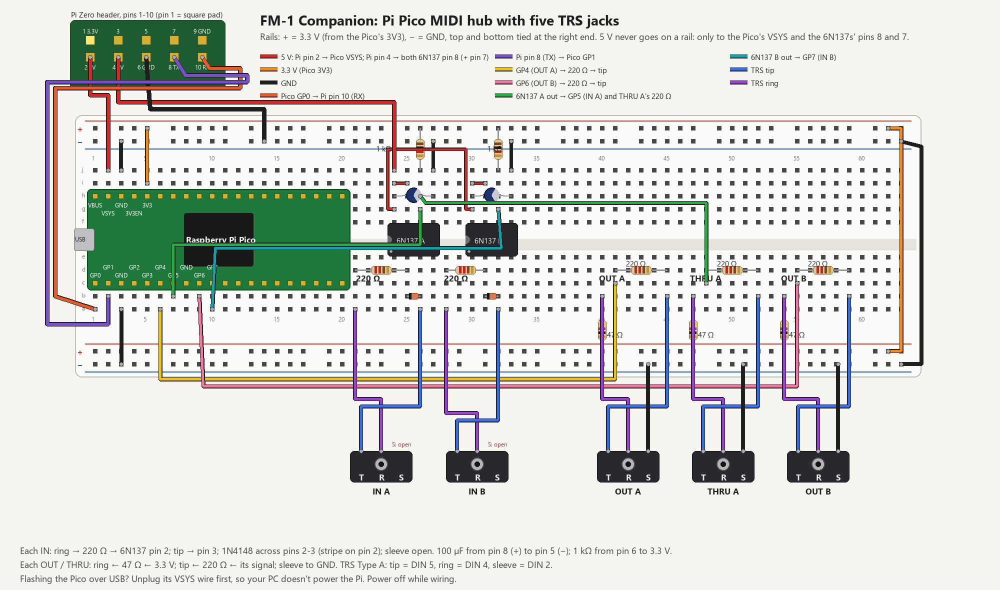

# Build plan: TRS MIDI IN and OUT/THRU jacks for the FM-1 Companion

Two 3.5 mm TRS jacks on the Pi Zero W: **MIDI IN**, and an output jack you can switch between **OUT**, **THRU**
and **OUT + THRU** from the box. They connect to the Pi's spare serial port (GPIO14/15), so the OLED HAT and
Bluetooth are untouched.

```
            ┌──────────── Pi Zero W ─────────────┐
TRS IN  ──▶ │ optocoupler ─▶ GPIO15 (RX, pin 10) │      USB ──▶ FM-1
TRS OUT ◀── │ 2 resistors ◀─ GPIO14 (TX, pin 8)  │      Bluetooth ◀─▶ headphones / MIDI devices
            └────────────────────────────────────┘
OUT jack mode (set on the box): OUT = FM-1/Bluetooth MIDI · THRU = copy of IN · OUT+THRU = both merged
```

## Two ways to build the hardware

- **A. With the Adafruit MIDI FeatherWing (ordered):** it already has the IN optocoupler and the OUT resistors,
  plus spots for 3.5 mm jacks next to the DIN sockets. Use DIN sockets, or your TRS jacks if they fit its
  footprint, and skip steps 2 and 3 below; wire its 3V, GND, TX and RX pads as in step 4.
- **B. From your own parts:** the circuits below on a small piece of perfboard. The IN half is the same as the
  6N138 circuit on your STM32 synth board.

The software is identical either way.

## 1. Parts (route B, as built: with a 6N137)

| Part | Qty | Used for |
|---|---|---|
| 3.5 mm stereo (TRS) jack | 2 | MIDI IN, MIDI OUT/THRU |
| **6N137** optocoupler | 1 | MIDI IN isolation (powered from 5 V, see step 2) |
| 1N4148 diode | 1 | across the 6N137's LED (pins 2–3, reversed) |
| **220 Ω** resistor | 2 | one: MIDI IN current limit (jack ring → pin 2) · one: MIDI OUT tip ← TX |
| **47 Ω** resistor | 1 | MIDI OUT ring ← 3.3 V |
| **1 kΩ** resistor | 1 | 6N137 output (pin 6) pull-up to **3.3 V** |
| **100 µF 16 V** electrolytic capacitor | 1 | 6N137 supply, pins 8 (+) and 5 (−), right at the chip (a 100 nF ceramic is ideal; add one later if the loopback shows errors) |
| *Optional:* 8-pin DIP socket | 1 | so the 6N137 isn't soldered in directly |
| Perfboard (about 3 × 5 cm) | 1 | |
| Hook-up wire | 5 | to Pi pins 1 (3.3 V), 2 (5 V), 6 (GND), 8 (TX), 10 (RX) |
| *Optional:* 2×20 stacking header | 1 | instead of soldering under the Pi's header (the OLED HAT covers it) |
| TRS male-to-male cable | 1–2 | OUT → IN loopback test; box → the FM-1's MIDI IN |
| *As needed:* TRS-to-DIN adapters (Type A) | | only for gear with 5-pin sockets |

Not needed: the TL072, a 74HC14 (THRU is done in software), the Adafruit FeatherWing (a ready-made alternative).
Other optocouplers would also do: an H11L1 or PC900V at 3.3 V with a 1 kΩ pull-up, or a 6N138 at 3.3 V with
470 Ω (see step 2).

**TRS wiring standard: Type A** (the common one; the FM-1's own TRS input uses it too, but if something
doesn't respond, a Type B cable or adapter swaps tip and ring):

| TRS | MIDI DIN pin | Role |
|---|---|---|
| Tip | 5 | current sink (data) |
| Ring | 4 | current source |
| Sleeve | 2 | shield / ground (OUT only) |

## 2. MIDI IN (optocoupler)

The sender drives a current through the optocoupler's LED; the Pi only sees the isolated output. **Never wire
the IN jack straight to a Pi pin**: MIDI is a current loop, and the spec requires the isolation.

**H11L1** (6-pin):
```
IN jack Ring ──[220 Ω]──▶ pin 1 (LED anode)
IN jack Tip  ───────────▶ pin 2 (LED cathode)
1N4148: cathode to pin 1, anode to pin 2 (across the LED, reversed)
IN jack Sleeve: not connected

pin 6 (Vcc) ── 3.3 V (Pi pin 1), 100 nF from pin 6 to pin 5
pin 5 (GND) ── GND (Pi pin 6)
pin 4 (out) ── GPIO15 RX (Pi pin 10), and ──[1 kΩ]── 3.3 V
```

**6N138** (8-pin) instead: LED anode pin 2, cathode pin 3 (same 220 Ω and diode), Vcc pin 8 to 3.3 V, GND pin
5, output pin 6 to RX with a **470 Ω** pull-up to 3.3 V; optionally 4.7–10 kΩ from pin 7 to GND for sharper
edges.

**6N137** (8-pin, the one in your parts box): it's specified for a 4.5–5.5 V supply, so **power it from 5 V**
and, because its output is open-collector, **pull the output up to 3.3 V**: the Pi's RX pin then never sees
more than 3.3 V.
```
IN jack Ring ──[220 Ω]──▶ pin 2 (LED anode)
IN jack Tip  ───────────▶ pin 3 (LED cathode)
1N4148: cathode to pin 2, anode to pin 3 (across the LED, reversed)
IN jack Sleeve: not connected

pin 8 (Vcc)    ── 5 V (Pi pin 2)
pin 7 (Enable) ── 5 V (tied high, not left floating)
pin 5 (GND)    ── GND (Pi pin 6); 100 nF from pin 8 to pin 5, right at the chip (required)
pin 6 (out)    ── GPIO15 RX (Pi pin 10), and ──[1 kΩ]── 3.3 V (Pi pin 1)   ← 3.3 V, not 5 V
pins 1, 4: not connected
```
With the 6N137 the Pi needs a fifth wire: **pin 2 (5 V)**. (A TL072 op-amp is no use here: it's an audio
part for ±12–15 V supplies, not a logic buffer.)

Pull-ups go to **3.3 V only**: the Pi's pins are not 5 V tolerant.

## 3. MIDI OUT (2 resistors)

```
3.3 V (Pi pin 1) ──[47 Ω]──▶ OUT jack Ring
GPIO14 TX (Pi pin 8) ──[220 Ω]──▶ OUT jack Tip   (or three 47 Ω in series)
GND (Pi pin 6) ──────────────▶ OUT jack Sleeve
```

MIDI's 3.3 V standard says 33 Ω and 10 Ω, but that assumes a sturdy driver chip. **A TRS plug shorts tip, ring
and sleeve for a moment while it goes in**, and with only 10 Ω the Pi's TX pin would see 100+ mA: too much for a
GPIO pin. With 220 Ω on the tip the loop still carries ~4 mA (enough for the FM-1 and nearly all gear; ~5–6 mA
with three 47 Ω instead) and a short is limited to ~15 mA for an instant.

## 4. Connect to the Pi

| Pi header pin | Signal | Goes to |
|---|---|---|
| 1 | 3.3 V | optocoupler pull-up (and Vcc for an H11L1 / 6N138), OUT ring 47 Ω |
| 2 | 5 V | **6N137 only:** its Vcc and Enable |
| 6 | GND | optocoupler GND, OUT sleeve |
| 8 | GPIO14 (TX) | OUT 220 Ω → tip |
| 10 | GPIO15 (RX) | optocoupler output |

The OLED HAT covers the header: solder the four wires to the underside of those pins, or fit a stacking header.
None of the four is used by the HAT. **Power off the Pi while wiring.**

## 5. Test the hardware (I'll do this over SSH, with Wi-Fi on)

1. **Serial port on:** the installer turns off the Linux login console on those pins and turns the serial
   hardware on (`raspi-config nonint do_serial_cons 1`, `do_serial_hw 0`); the port is `/dev/ttyS0`.
2. **Loopback:** a TRS cable from OUT to IN; bytes sent at 31,250 baud must come back unchanged (thousands of
   them, including SysEx). This tests both halves without any other gear.
3. **Real gear:** OUT → the FM-1's TRS MIDI IN (notes play), a keyboard → IN (notes reach the FM-1 and
   Bluetooth).

## 6. Software (I'll build it)

- **Serial MIDI endpoint** in the Companion's MIDI process (`blemidi.py`): `/dev/ttyS0` at 31,250 baud (exact with
  the Pi's fixed 250 MHz core clock), parsed with the Companion's existing MIDI parser (running status, SysEx,
  real-time messages).
- **OUT jack mode:** OUT, THRU (a copy of IN, about 1–2 ms behind), or OUT + THRU merged.
- **Routing settings** (box and web page): IN → FM-1, IN → Bluetooth, FM-1 → OUT, Bluetooth → OUT, MIDI clock to
  OUT on/off. The FM-1's and the box's own SysEx (library, updates) never go out of the jack.
- **Status:** the MIDI line shows jack activity; Settings gains a *MIDI jacks* page.
- **Install:** serial setup in `install.sh`; tests with a pretend serial port (loopback, THRU timing, routing);
  README and screen images.

## Notes

- **Software THRU works only while the Companion runs** (not while the Pi is off or starting up). A hardware THRU
  (a 74HC14 buffer from the optocoupler's output to a third jack) would pass MIDI with the Pi off, and can be
  added later without changing the code.
- Keep Bluetooth on its own serial port: moving it to the weaker one to free the better one for MIDI would cost
  headphone audio quality.

## Route C: a Pi Pico hub with five TRS jacks (IN A, OUT A, THRU A, IN B, OUT B)



The Pi Zero has one spare serial port, so a Raspberry Pi Pico takes the MIDI jacks and talks to the Pi over that
one port. Two 6N137s for the two INs, everything else is resistors.

| From | To |
|---|---|
| Pi pin 2 (5 V) | Pico pin 39 (VSYS) |
| Pi pin 4 (5 V) | 6N137 A and B pin 8 (and pin 7, Enable) |
| Pi pin 6 (GND) | GND rails, Pico pins 3 and 38 |
| Pi pin 8 (TX, GPIO14) | Pico pin 2 (GP1, UART0 RX) |
| Pi pin 10 (RX, GPIO15) | Pico pin 1 (GP0, UART0 TX) |
| Pico pin 36 (3V3) | + rails (3.3 V) |
| IN A: ring → 220 Ω → 6N137 A pin 2, tip → pin 3 | 6N137 A pin 6 → Pico pin 7 (GP5), 1 kΩ to 3.3 V |
| IN B: ring → 220 Ω → 6N137 B pin 2, tip → pin 3 | 6N137 B pin 6 → Pico pin 10 (GP7), 1 kΩ to 3.3 V |
| OUT A: ring ← 47 Ω ← 3.3 V, tip ← 220 Ω ← | Pico pin 6 (GP4, UART1 TX) |
| THRU A (hardware): ring ← 47 Ω ← 3.3 V, tip ← 220 Ω ← | 6N137 A pin 6 (the IN A signal) |
| OUT B: ring ← 47 Ω ← 3.3 V, tip ← 220 Ω ← | Pico pin 9 (GP6, PIO TX) |
| Each 6N137 | 1N4148 across pins 2-3 (stripe on pin 2), 100 µF from pin 8 (+) to pin 5 (−), pin 5 to GND |
| OUT/THRU sleeves | GND; IN sleeves open |

5 V never goes on a rail (the Pico's and the Pi's pins are 3.3 V only). To flash the Pico over USB, unplug its
VSYS wire first so the computer doesn't power the Pi through it. Each OUT can also be switched in software to
THRU A or THRU B; the Pico does that copy itself, so it's near-instant.
