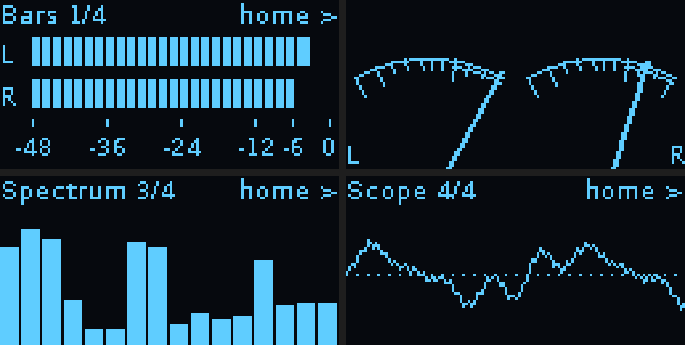
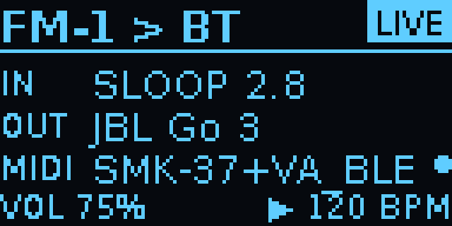
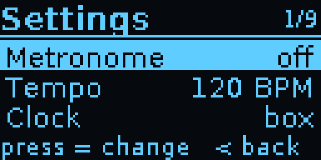
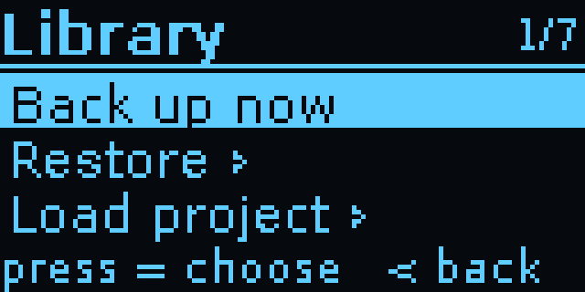
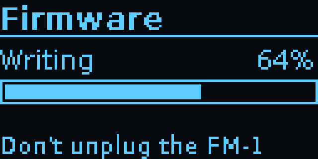

# FM-1 Bluetooth bridge

A Raspberry Pi Zero W with a Waveshare 1.3" OLED HAT that gives the M-VAVE FM-1 Bluetooth:

- **Audio out:** the FM-1's USB audio goes to Bluetooth headphones or a speaker.
- **MIDI in and out:** the Pi shows up as a Bluetooth MIDI device called **"FM-1 Bridge"**. MIDI
  passes both ways between it and the FM-1's USB MIDI, so an iPad, phone or computer can play the
  FM-1 and receive what you play on it.
- **A library for the FM-1 (SLOOP):** back up and restore everything on it, load projects and samples,
  and install firmware updates, from the box or from your phone, with no computer.

Audio and MIDI work with any FM-1 firmware that shows up as a USB audio and MIDI device, such as Sloop
("Felucca"). The library needs SLOOP 2.3 or later (firmware installs work with any `.fwsc` package
SLOOP's installer accepts).

```
                         ┌──Bluetooth A2DP───▶ headphones / speaker
FM-1 ──USB──▶ Pi Zero W ─┤
 (audio + MIDI)          └◀─Bluetooth LE MIDI─▶ iPad / phone / Mac
```

## What you need

- Pi Zero W with the Waveshare 1.3" OLED HAT (SH1106, KEY1–3 and a joystick)
- microSD card (8 GB or more)
- A **micro-USB OTG adapter** and a cable to the FM-1, plugged into the Zero's port labelled **USB**
- A good **5 V 2.5 A** supply into the port labelled **PWR**. The Zero powers the FM-1 too.

## Set up

1. **Flash the card** with Raspberry Pi Imager: choose *Raspberry Pi Zero W*, then
   *Raspberry Pi OS Lite (32-bit)*. In the settings, set a hostname (for example `fm1bridge`),
   a user name and password, your Wi-Fi, and **enable SSH**. Wi-Fi is only needed for setup.
2. **Boot the Zero** (give it a few minutes the first time). On your computer, copy this folder over:
   ```
   scp -r fm1-bt-bridge YOUR_USER@fm1bridge.local:~
   ```
3. **Install** over SSH:
   ```
   ssh YOUR_USER@fm1bridge.local
   bash fm1-bt-bridge/install.sh
   sudo reboot
   ```
   The install takes 10–20 minutes on a Zero W.
4. **Pair your headphones** and check MIDI (below), then **turn Wi-Fi off** on the device:
   joystick right → *Wi-Fi* → press. That frees the shared radio chip for Bluetooth. Wi-Fi stays off
   after reboots until you turn it back on the same way, for example to SSH in for an update.

The screen shows the bridge about 30–40 seconds after power-on.

## Using it

| Control | Status screen | Headphone list | Settings |
|---|---|---|---|
| **KEY1** | Scan for headphones | Scan again | – |
| **KEY2** | Reconnect headphones · *hold*: disconnect | – | – |
| **KEY3** | *Hold 3 s*: shut down safely | *Hold 3 s*: shut down | *Hold 3 s*: shut down |
| **Joystick up/down** | Volume | Move | Move |
| **Joystick press** | – | Pair the selected headphones | Change the setting |
| **Joystick right** | Open settings | Pair | Change the setting |
| **Joystick left** | Open the meters | Back | Back |

**Meters** (joystick left from the status screen): the FM-1's sound as **Bars** (peak level with peak
hold), **VU** (two needles, 0 VU = −18 dBFS), **Spectrum** (16 bands, 50 Hz–7.5 kHz) or **Scope** (the
waveform). Joystick up/down switches meter (the choice is remembered); right goes back. The screen
stays on while sound plays. The first time after a boot it shows "Loading meters..." for about 8 s.
They take about a quarter of the Zero W's CPU while shown, and nothing otherwise.



**The status screen:**



- **LIVE**: audio is flowing from the FM-1 to the speaker.
- **IN**: the FM-1, as its firmware names it (Sloop: "Felucca").
- **OUT**: the speaker or headphones.
- **MIDI**: the Bluetooth MIDI device connected. The dot blinks with MIDI traffic.
- **VOL**: the speaker volume (joystick up/down).

To protect the OLED from burn-in, the screen dims after a minute. After five minutes it shows only
a small **FM-1 LIVE** (or *idle*) that moves around the screen, so you can still tell it's running.
Any key brings the full screen back; that key press does nothing else.

Always shut down with **KEY3** (hold) before pulling the power. Pulling the power on a running Pi
can lose recently changed files or corrupt the SD card.

**Settings** (joystick right; six rows, three at a time):



| Setting | What it does |
|---|---|
| **Library ›** | Backups, projects, samples and firmware (below). |
| **Speaker** | The paired speaker or headphones. Press to scan for and pair a different one (same as KEY1). |
| **BT audio** on/off | Connects or disconnects the speaker (same as KEY2 and holding KEY2). |
| **BLE MIDI** on/off | Shows or hides "FM-1 Bridge" to MIDI apps. It's remembered. |
| **Pairing** | Opens a 2-minute window in which a device can pair with the bridge. Only needed on systems that want to pair first (below). |
| **Wi-Fi** on/off | Switches the Wi-Fi radio. It's remembered across reboots. With Wi-Fi off, SSH is unavailable. |

### Headphones

Put your headphones in pairing mode, press **KEY1**, wait about 10 s, pick them with the joystick
and press. They're remembered: on later boots the bridge reconnects by itself every 20 seconds
until the headphones answer.

### Bluetooth MIDI

Connect from your device's MIDI app; you don't pair through the system Bluetooth settings:

- **iPad / iPhone:** in GarageBand, AUM, Drambo and similar apps, open the app's
  *Bluetooth MIDI Devices* page and tap **FM-1 Bridge**.
- **Mac:** *Audio MIDI Setup* → *Window* → *Show MIDI Studio* → the Bluetooth button →
  **FM-1 Bridge** → *Connect*.
- **Android:** use an app that supports Bluetooth MIDI (for example *MIDI BLE Connect*), then your
  music app.
- **Windows:** open **Pairing** in the bridge's settings, then pair "FM-1 Bridge" in Windows'
  Bluetooth settings within 2 minutes. Whether a Windows music app can use Bluetooth MIDI depends on
  the app.

Then MIDI flows both ways:

- **From your device:** notes, CCs, program changes, clock and SysEx go to the FM-1, exactly as
  over a USB cable. For example, in Sloop, channels 1–3 play the synths and channel 10 the drums.
- **From the FM-1:** whatever it sends over USB MIDI (keys, sequencer, clock, depending on the
  firmware's MIDI settings) goes to your device.

## Library: backups, projects, samples, firmware

The box talks to SLOOP (2.3 or later) the way SLOOP's own web editor does, over the same USB cable.
Its backups are **SLOOP backup files** (`sloop-backup` JSON): they open in SLOOP's web editor, and
backups made there can be restored from the box.

**SLOOP or Clipper:** both are isod89's firmwares, based on Felucca. [SLOOP](https://github.com/isod89/sloop-fm1)
is a groovebox (tracks, drums, songs, samples); [Clipper](https://github.com/isod89/clipper-fm1) is a
synthesizer (23 engines, one instrument) and is **experimental**: its own README says it has run very little
on a real FM-1. The box installs either and switches between them (the file of the other one stays in the
library, so you can always go back). Backups, projects and samples belong to the firmware they came from:
the box refuses to put a SLOOP backup or project onto Clipper, or the other way round, and Clipper has
wavetable slots instead of sample slots (use Clipper's web editor for those). Backing up and restoring
Clipper's own data works the same way as SLOOP's.

**On the box:** Settings → **Library**:



| Item | What it does |
|---|---|
| **Back up now** | Saves everything on the FM-1: the working project, projects A–D, settings, user presets, the FM6 bank, the SYN drum kits, the MIDI map, the theme and the four sample slots. |
| **Restore ›** | Pick a backup; it replaces what's on the FM-1. |
| **Load project ›** | Pick a project file, or a project inside any backup, then where it goes: the working project or A–D. |
| **Load sample ›** | Pick a WAV, then a slot (USR1–4). |
| **Firmware ›** | Pick a firmware file to install. With Wi-Fi on, **Get SLOOP update** and **Get Clipper (exp.)** download the newest release from GitHub first. |
| **Import SD card** | Copies new files from the SD card's `fm1-library` folder (below). |
| **Auto backup** | Press to choose: **off**, **at start**, or every **2**, **5**, **10** or **30 min**. Remembered. |



**Safe by design:**
- Anything that writes to the FM-1 **makes a backup first** and asks you to **hold the joystick press
  for 2 seconds**. A short press only reminds you to hold.
- It refuses while the FM-1's song plays (stop it first).
- During a firmware install the screen says *Don't unplug the FM-1*, KEY3 won't shut down, and
  Bluetooth MIDI pauses. It takes about 2 minutes. Your projects, presets and samples stay.
- **Automatic backups** (Library → *Auto backup*): *at start* (the default) backs up once whenever the
  box starts with the FM-1 connected; *2 / 5 / 10 / 30 min* also backs up at that interval while the FM-1
  is connected. A backup only reads the FM-1 (about 7 seconds), so it's fine while the song plays, and
  the status screen shows *backup NN%* in its corner. If nothing changed since the last automatic
  backup, no new file is kept. The newest 20 automatic backups are kept; the ones you make, and those
  made before a restore, a load or an install, are never deleted.

**From your phone or computer:** with Wi-Fi on (Settings → Wi-Fi), open **http://fm1bridge.local**
(or the Pi's IP address). The page lists the library and does everything the box does, plus:
- **upload** WAVs, firmware (`.fwsc`), backups and project files; **download** backups, and any
  project of a backup as its own project file to share;
- load **several WAVs into one slot**: each becomes a key zone, with its root note taken from the file
  name (`bass_C2.wav`, `lead_A4.wav`). A slot holds about 7 seconds in all.

Anything on the page that writes to the FM-1 still has to be **confirmed on the box** (hold press), so
nothing on your network can change the FM-1 without you.

**Using the SD card:** the card's **bootfs** drive (the one you see on a computer) has an
`fm1-library` folder with `backups`, `firmware`, `projects` and `samples`. Drop files into those
folders from a computer and choose *Import SD card*; backups are copied there too, so you can take
them off the card.

**Over SSH,** the same jobs run from the command line:
```
python3 ~/.local/share/fm1-bridge/library.py backup
python3 ~/.local/share/fm1-bridge/library.py --help
```

## Good to know

- **Connect the FM-1 before you power the Pi.** Plugging it in while the Pi is running can reboot
  the Pi: the Zero's USB port has no current limit, so the FM-1's surge (it also charges its
  battery) briefly drops the supply voltage. A strong 5 V 2.5 A supply with a short cable helps. A
  powered USB hub between the OTG adapter and the FM-1 avoids it completely.
- **Latency:** headphone audio (Bluetooth SBC) adds roughly 150–250 ms. That's fine for listening
  and practising, and noticeable when you play tightly in time. Bluetooth MIDI adds only about
  10–20 ms.
- **MIDI clock over Bluetooth** jitters slightly with the Bluetooth connection timing. That's usable,
  but a cable is tighter if Sloop has to follow a DAW's tempo exactly.
- **Audio and MIDI share one radio.** With Wi-Fi off it copes well. If the headphones drop out
  while MIDI is busy (dense clock plus notes), it's the radio sharing airtime.
- The FM-1's USB rate (Sloop: GLO → SYSTEM → USB RATE) can be 44.1 or 48 kHz. Both work.
- **Start-up takes about a minute** on a Zero W ("Starting..." shows first). Raspberry Pi OS Trixie
  took nearly 3 minutes; the installer turns off cloud-init, keeps swap in RAM, and lets the bridge
  start without waiting for the network. Wi-Fi comes up about 40 s after the bridge.
  To save another ~60 s, move your Wi-Fi from Trixie's netplan profiles to a plain NetworkManager
  profile (each netplan profile costs a ~20 s systemd reload at boot). Over SSH, with Wi-Fi on:
  `sudo setsid -w sh config/fm1-native-wifi; sudo tail -n 1 /root/fm1-native-wifi.log`. The SSH session
  may drop while Wi-Fi switches; if the new profile doesn't connect, the script switches back.

## Troubleshooting

**The screen is upside down or mirrored.** The bridge is set up for the HAT held with KEY1–3 on
the left and the cables hanging down. Waveshare's printed labels then read upside down, so the
joystick's directions are turned round to match the screen. To hold it the other way, turn the
screen around in the settings file and restart the bridge; the joystick follows by itself (set
`"flip_joystick"` to `true` or `false` only to override that):
```
python3 -c "import json,pathlib as p;f=p.Path.home()/'.config/fm1-bridge/fm1-bridge.json';d=json.loads(f.read_text()) if f.exists() else {};d['rotate']=180;f.parent.mkdir(parents=True,exist_ok=True);f.write_text(json.dumps(d))"
systemctl --user restart fm1-bridge
```
To check the orientation, stop the bridge and draw a test pattern:
```
systemctl --user stop fm1-bridge
python3 ~/.local/share/fm1-bridge/bridge.py --test-screen
systemctl --user start fm1-bridge
```

**The screen stays dark.** Check that SPI is on (`ls /dev/spidev0.0`) and look at the log:
```
journalctl --user -u fm1-bridge -n 50
```

**I turned Wi-Fi off and need SSH again.** On the device: joystick right → *Wi-Fi* → press. After
about 20 seconds, `ssh YOUR_USER@fm1bridge.local` works again.

**"FM-1 not found" or MIDI shows "(no FM-1)".** Check the OTG adapter is in the port labelled USB,
then see whether Linux sees the FM-1's audio and MIDI ports:
```
wpctl status
aconnect -l
```
If your firmware uses a name the bridge doesn't recognise, add a word from that name to
`source_match` in `~/.config/fm1-bridge/fm1-bridge.json`. Any other USB device is used as a fallback.

**"FM-1 Bridge" doesn't show up in MIDI apps.** Check *BLE MIDI* is on in the settings and the MIDI
line doesn't say *BT error*. If it does, the log explains why
(`journalctl --user -u fm1-bridge -n 50`). If the device connected to an older version of the
bridge, forget "FM-1 Bridge" in its Bluetooth settings and connect again.

**"Audio service not ready" when connecting headphones.** PipeWire's Bluetooth support isn't running:
```
systemctl --user status wireplumber
```

**Crackles or dropouts.** Make sure Wi-Fi is off. The buffer is already 2048 frames (that measured
glitch-free on a Zero W); if it still crackles, raise `default.clock.quantum` and
`default.clock.min-quantum` to `4096` in `~/.config/pipewire/pipewire.conf.d/10-fm1-bridge.conf`
and reboot. `pw-top` shows the glitch counts in its ERR column.

**A library job failed.** The job screen (and the web page's *Now* line) gives the reason: most often
*stop the song on the FM-1 first*, or *FM-1 not found on USB*. A backup made before a failed write is
in the library (`…_before-restore`, `…_before-flash`…): restore it to go back.

**A firmware install was cut off** (unplugged, power lost). The FM-1 waits in update mode. Run the
same install again from the box or the web page: it finishes the write.

**No audio after a firmware install.** The bridge notices when PipeWire loses the FM-1 after it
restarts and fixes it within about half a minute. If audio is still missing, restart the bridge:
`systemctl --user restart wireplumber fm1-bridge`.

**Forget the headphones and start over:**
```
bluetoothctl remove AA:BB:CC:DD:EE:FF
```
Then pair again with KEY1.

## Files

| File | Installed to | Purpose |
|---|---|---|
| `bridge.py` | `~/.local/share/fm1-bridge/` | The OLED app, headphone control and audio routing |
| `blemidi.py` | `~/.local/share/fm1-bridge/` | Bluetooth LE MIDI service and its link to the FM-1's USB MIDI |
| `libui.py` | `~/.local/share/fm1-bridge/` | The Library screens on the box |
| `meters.py` | `~/.local/share/fm1-bridge/` | The meter screen (bars, VU, spectrum, scope) |
| `library.py` | `~/.local/share/fm1-bridge/` | The library's jobs (backup, restore, projects, samples, firmware); also a command-line tool |
| `sloop.py` | `~/.local/share/fm1-bridge/` | SLOOP's editor protocol: backups, projects, sample slots |
| `web.py` | `~/.local/share/fm1-bridge/` | The web page |
| `vendor/sloop/` | `~/.local/share/fm1-bridge/vendor/sloop/` | SLOOP's installer and sample converter, unchanged (see `VENDORED.md`) |
| `config/fm1-bridge.service` | `~/.config/systemd/user/` | Starts the app at boot |
| `config/fm1-web.service` | `~/.config/systemd/user/` | Starts the web page at boot |
| `config/fm1-sd-sync` | `/usr/local/sbin/` | Copies backups to the SD card (root helper, run through sudo) |
| `config/systemd-user-sessions.service` | `/etc/systemd/system/` | Starts the user services without waiting for the network (faster boot) |
| `config/rpi-swap-50-fm1-bridge.conf` | `/etc/rpi/swap.conf.d/50-fm1-bridge.conf` | Swap in RAM only (no swap file rebuilt at every boot) |
| `config/fm1-native-wifi` | (run once by hand, see Good to know) | Moves Wi-Fi to a plain NetworkManager profile (faster boot) |
| (library) | `~/fm1-library/` | Your backups, projects, samples and firmware |
| `config/pipewire-10-fm1-bridge.conf` | `~/.config/pipewire/pipewire.conf.d/` | Larger buffers for the Zero W |
| `config/wireplumber-51-fm1-bridge.conf` | `~/.config/wireplumber/wireplumber.conf.d/` | Headless Bluetooth, A2DP source only, PipeWire's own BLE MIDI off (WirePlumber 0.5) |
| `config/wireplumber-51-fm1-bridge.lua` | `~/.config/wireplumber/bluetooth.lua.d/` | The same for WirePlumber 0.4 (Bookworm) |
